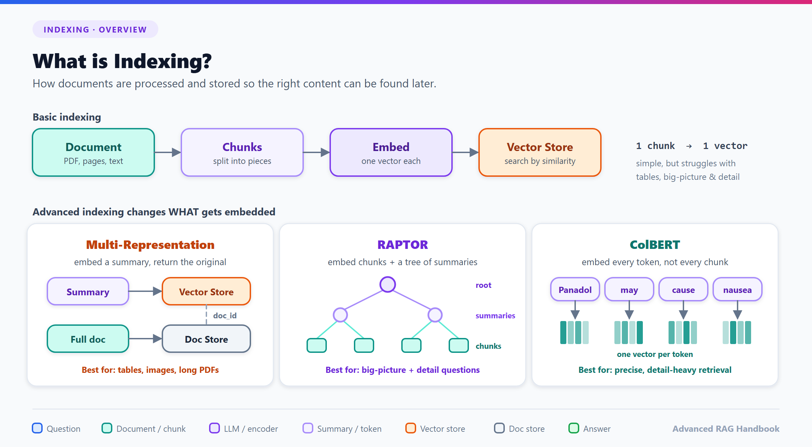
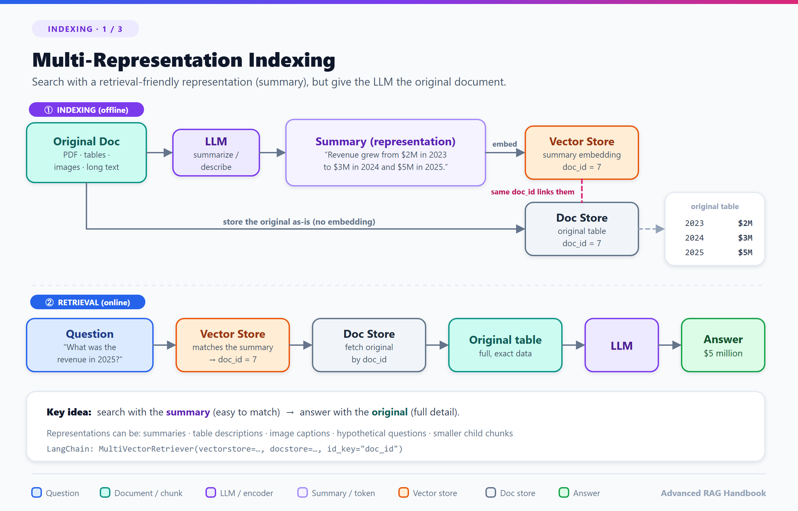
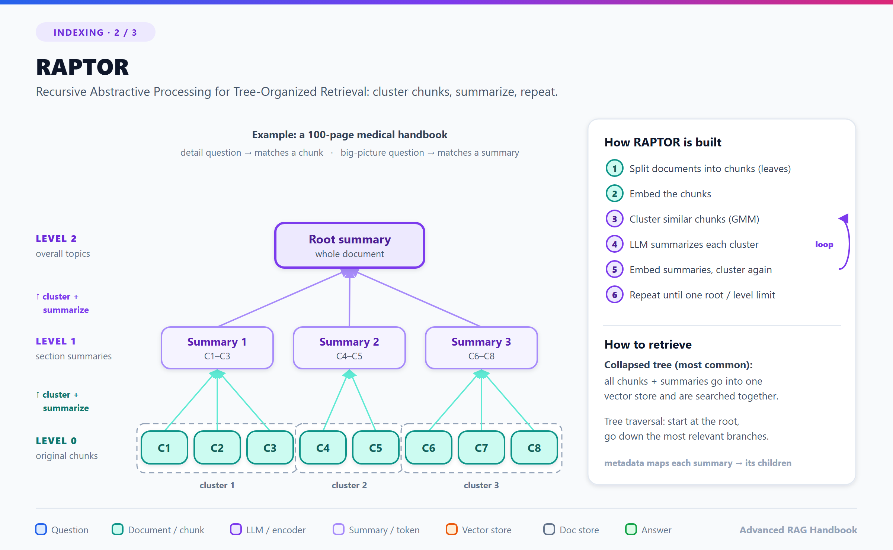
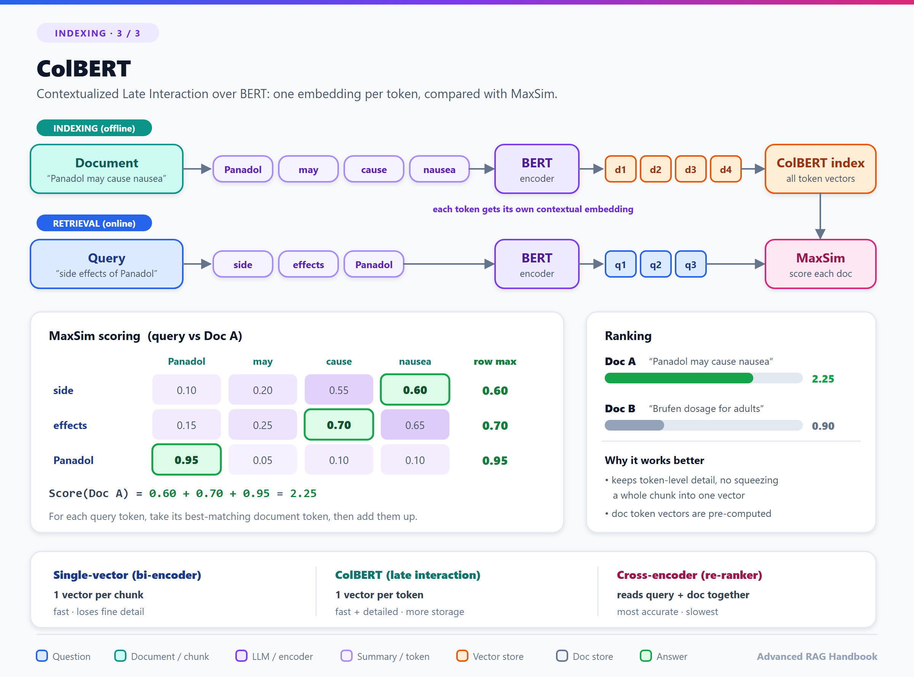
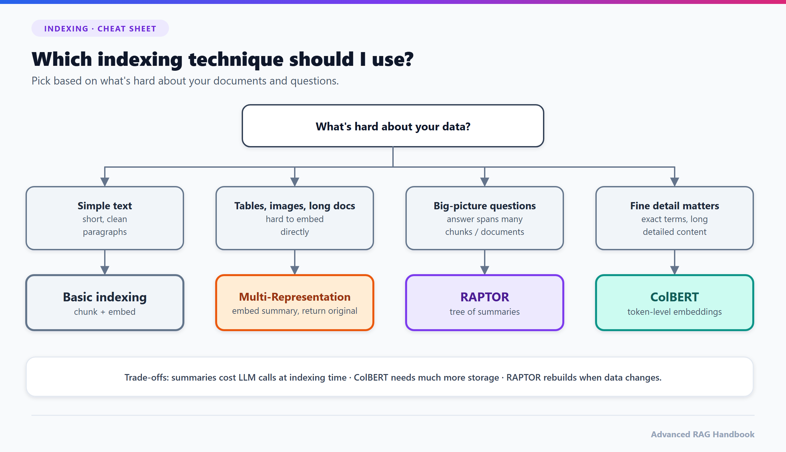

# Indexing in RAG

> Interview prep notes: concepts, definitions, diagrams, and trade-offs.

---

## What is Indexing?

**Interview definition:**
> Indexing is the **offline stage** of RAG where documents are **processed, split, embedded, and stored** (in a vector store and/or document store) so that relevant content can be **retrieved quickly and accurately** at query time.

**Basic indexing:** `Document → Chunks → Embed each chunk → Vector store` (1 chunk = 1 vector).

### Chunk overlap: how basic chunking keeps context
When a text splitter cuts a document into chunks, a sentence can get **split across two chunks** and lose its meaning:

- Chunk 1 ends: *"The main advantage of RAG is that it…"*
- Chunk 2 starts: *"…retrieves relevant information before generating an answer."*

**Chunk overlap** fixes this by **repeating some text** between neighbouring chunks:

```
Chunk 1: sentences 1–5
Chunk 2: sentences 4–8    ← sentences 4–5 repeated
Chunk 3: sentences 7–11   ← sentences 7–8 repeated
```

In LangChain: `RecursiveCharacterTextSplitter(chunk_size=1000, chunk_overlap=200)`.

> **Note:** Python doesn't actually *understand* or *remember* context. Overlap just **repeats some text** so each chunk carries enough surrounding information. That helps at chunk boundaries, but it can't fix bigger problems like tables, images, or questions spanning many chunks. Those need the advanced techniques below.

**Why do we need advanced indexing?** Basic indexing struggles with:

- **Tables, images, long documents**: hard to embed meaningfully as raw chunks.
- **Big-picture questions**: the answer is spread across many chunks, and no single chunk contains it.
- **Fine detail**: squeezing a whole chunk into **one vector** loses token-level meaning.

**Core idea:** *Advanced indexing changes **what gets embedded**, so retrieval finds the right content.*



**The 3 advanced indexing techniques at a glance:**

| # | Technique | What gets embedded | Solves |
|---|-----------|--------------------|--------|
| 1 | Multi-Representation | A **summary / description** of each document (original kept separately) | Tables, images, long docs |
| 2 | RAPTOR | Chunks **+ a tree of summaries** at different levels | Big-picture + detail questions |
| 3 | ColBERT | **Every token** gets its own embedding | Fine-grained, precise retrieval |

---

## 1. Multi-Representation Indexing

### Interview definition
> Multi-Representation Indexing is a RAG technique in which we create **alternative representations** of original documents, such as **summaries, table descriptions, or image descriptions**. These representations are **embedded and stored in a vector database**, while the **original documents are preserved in a document store**. During retrieval we search using the representations, then **fetch the corresponding original documents by their IDs** and pass them to the LLM.

### Simple explanation
Some content is **easy to understand but hard to search**: a big table, a chart, a 20-page section. So we let an LLM write a short, search-friendly **summary** of it. We **search with the summary** (it matches questions well), but we **answer with the original** (it has the full, exact data).

**Example:** a financial report contains this table:

| Year | Revenue |
|------|---------|
| 2023 | $2 million |
| 2024 | $3 million |
| 2025 | $5 million |

LLM-generated summary: *"The company's annual revenue increased from $2 million in 2023 to $3 million in 2024 and $5 million in 2025."*

- The **summary** is embedded → stored in the **vector store** with `doc_id = 7`.
- The **original table** → stored in the **doc store** with the same `doc_id = 7`.
- Question *"What was the revenue in 2025?"* → matches the summary → `doc_id = 7` → fetch the original table → LLM answers **$5 million**.

### Diagram


### How it works
**Indexing (offline)**
1. Load original documents (PDFs, tables, images, long text).
2. LLM (or a vision model, for images) generates a **representation** for each one.
3. **Embed the representation** → store it in the **vector store** with a `doc_id`.
4. Store the **original document** in a **doc store** with the same `doc_id`.

**Retrieval (online)**
1. Embed the user question.
2. Similarity search finds the best-matching **representation**.
3. Use its `doc_id` to **fetch the original** from the doc store.
4. Pass the **original** + question to the LLM.

### Is the summary also passed to the LLM?
**No, not necessarily.** The summary's job ends once it has helped **find** the right document.

| | Used for | Goes to the LLM? |
|--|----------|------------------|
| **Summary** | **Searching**: matching the question in the vector store | ❌ Usually not |
| **Original content** | **Answering**: full, detailed context | ✅ Yes |
| **User's question** | Both | ✅ Yes |

**Example:**
- Summary: *"This section explains RAG architecture."* → used only to **find** it.
- Original: the full paragraphs explaining RAG architecture → used to **answer**.

**Remember:** *the summary helps find the right information; the original content provides the detail for answering.*

### Types of representations
| Representation | Original content | Use case |
|----------------|------------------|----------|
| **Summary** | Long document / section | Large PDFs, policies, reports |
| **Table description** | Table | Financial reports, Excel, tabular PDFs |
| **Image description** | Diagram / chart / image | Technical diagrams, image-heavy PDFs |
| **Hypothetical questions** | Chunk | "Which questions does this chunk answer?" |
| **Smaller child chunks** | Larger parent chunk | Parent-document retrieval |

> In LangChain: `MultiVectorRetriever(vectorstore=..., docstore=..., id_key="doc_id")`. The `vectorstore` holds the representation embeddings, the `docstore` holds the originals, and `doc_id` connects them.

### When to use
- Documents with **tables, images, charts**, or **very long** sections.
- When small chunks lose context, but big chunks are hard to retrieve.
- When you want the LLM to see the **full original** content, not a fragment.

### Advantages
- **Better retrieval** for complex content (tables, images, long text).
- LLM answers from the **actual source**, not just a summary.
- Flexible: several representations can point to one original.

### Limitations
- **Extra LLM calls at indexing time** to create summaries / descriptions (cost and time).
- Needs **two stores** and careful **ID mapping**.
- A **bad summary** means the document is never retrieved.
- Returned originals can be **long**, which uses more tokens in the final prompt.

### Multi-Query vs Multi-Representation (names sound similar)
| | Multi-Query | Multi-Representation |
|--|-------------|----------------------|
| What changes | The **user's query** | How **documents** are represented |
| Generates | Multiple query variations | Multiple document representations |
| Side | Query side | Document / index side |
| When applied | At **retrieval** time | At **ingestion / indexing** time |

---

## 2. RAPTOR

**RAPTOR = Recursive Abstractive Processing for Tree-Organized Retrieval**

### Interview definition
> RAPTOR is an indexing technique that organizes documents into a **tree of summaries**. It **embeds and clusters** chunks, uses an LLM to **summarize each cluster**, then **repeats** this recursively on the summaries. All levels (original chunks + summaries) are indexed, so retrieval can match **specific details** or **high-level themes**.

### Simple explanation
Normal RAG retrieves a few small chunks, which is great for detail questions. But a question like *"What are the main themes of this handbook?"* needs information **spread across many chunks**. No single chunk has it.

RAPTOR builds a **tree**:

| Level | Contains | Answers |
|-------|----------|---------|
| **Level 0 (leaves)** | Original chunks | Specific details |
| **Level 1** | Summaries of clusters of chunks | Section-level questions |
| **Level 2+ (root)** | Summaries of summaries | Overall topics / big picture |

**Example:** a 100-page medical handbook.
- *"What is the dose of Panadol for adults?"* → matches a **leaf chunk**.
- *"What does this handbook cover overall?"* → matches the **root summary**.

### Worked example: building a small tree
A document about AI, split into 4 chunks:

| Chunk | Content |
|-------|---------|
| C1 | What is Machine Learning? |
| C2 | Types of Machine Learning |
| C3 | What is Deep Learning? |
| C4 | Neural Networks |

1. **Embed** C1–C4.
2. **Cluster by meaning:** Cluster 1 = {C1, C2}, Cluster 2 = {C3, C4}. Grouping is by **meaning**, not by page position.
3. **LLM summarizes each cluster** → new **parent nodes**:
   - **P1**: *"Machine learning is a branch of AI, with several learning approaches."*
   - **P2**: *"Deep learning uses neural networks to learn complex patterns."*
4. **Repeat** on P1 + P2 → **Root**: *"Overview of Artificial Intelligence."*

```
                Root: Overview of AI               ← Level 2 (big picture)
               /                    \
   P1: Machine Learning      P2: Deep Learning     ← Level 1 (section summaries)
       /        \                /        \
     C1          C2            C3          C4      ← Level 0 (original chunks)
```

Now *"Explain the relationship between Machine Learning and Deep Learning"* can match **P1, P2, or the Root**. Each of those already combines several chunks, which no single chunk could do.

### Diagram


### How it works
1. **Chunk** the documents (about **100 tokens** per chunk in the original paper). These chunks are the **leaf nodes**.
2. **Embed** the chunks.
3. **Cluster** semantically similar chunks (the paper uses a Gaussian Mixture Model, so one chunk can belong to more than one cluster).
4. An **LLM summarizes each cluster**, which creates a new layer of nodes.
5. **Embed the summaries** and **cluster them again**.
6. **Repeat** until clustering is no longer useful, a single root is reached, or a level limit is hit.
7. Store metadata linking each summary to its children (which chunks belong to which summary).

### What is stored, and where?
**Everything searchable goes into the vector store**: original chunks **and** summaries, each with its own embedding.

| What | Where |
|------|-------|
| Original chunks (C1, C2, C3 …) + their embeddings | **Vector store** |
| Summaries (P1, P2 …, root) + their embeddings | **Vector store** |
| Parent-child links (which chunks belong to which summary) | **Tree structure / metadata** |

```
Vector store
├── C1: original chunk text  + embedding
├── C2: original chunk text  + embedding
├── P1: summary of C1–C3     + embedding
├── P2: summary of C4–C5     + embedding
└── R:  root summary         + embedding
```

> ⚠️ **Key difference from Multi-Representation:** Multi-Rep embeds the **summary** but keeps the **original in a separate doc store**, and the LLM receives the original. RAPTOR stores **both chunks and summaries as searchable nodes in the vector store**, and **whatever node matches** (chunk or summary) is passed to the LLM. There's no separate doc-store lookup.

### How is retrieval done?
**Example:** *"What are the main concepts of AI?"*

1. **Embed the question.**
2. **Search the vector store** for similar nodes, at **every level**. It might find:
   - P1: summary about Machine Learning
   - P2: summary about Deep Learning
   - C1: original chunk introducing AI
3. **Select the relevant nodes**, using one of two strategies:
   - **Collapsed tree (most common):** search **all nodes together** (chunks + summaries), pick the top matches from any level.
   - **Tree traversal:** start at the **top-level summaries**, pick the most relevant ones, then go **down to their children**, level by level.
4. **Pass the retrieved nodes + the question** to the LLM.
5. **LLM generates** the final answer.

| Component | Job |
|-----------|-----|
| **Vector store** | Finds relevant chunks **and** summaries using embeddings |
| **Tree structure** | Keeps the summary → child-chunk relationships (needed for tree traversal) |
| **LLM** | Writes the summaries during indexing, and generates the answer at query time |

**Key idea:** RAPTOR searches at **multiple levels of detail**, not just at the original chunk level.

### RAPTOR vs Multi-Representation
Both use LLM summaries, so they're easy to mix up.

| | Multi-Representation | RAPTOR |
|--|----------------------|--------|
| What gets summarized | **Individual** documents / chunks / tables | **Clusters** of similar chunks |
| Summary levels | Usually **one** | **Multiple** (recursive tree) |
| Where originals live | Separate **doc store** | In the **vector store**, as leaf nodes |
| What is searched | Summaries only | Summaries **and** original chunks, at every level |
| What the LLM receives | The **original** (summary is only for search) | **Whatever node matched**: chunk or summary |

> **Interview line:** *"RAPTOR builds a hierarchical tree by recursively embedding, clustering, and summarizing text chunks. This lets RAG retrieve information at both a detailed and a high-level of abstraction."* (Sarthi et al., **ICLR 2024**)

### When to use
- **Long documents** or **large collections** where questions need **big-picture** understanding.
- Questions that combine information **across many chunks or documents**.
- Mixed workloads: both detail questions and summary questions.

### Advantages
- Handles **both detail and high-level** questions from the same index.
- Summaries **combine information** spread across many chunks.
- Better results on long-document question answering than flat chunk retrieval.

### Limitations
- **Expensive to build**: many LLM summarization calls.
- **Slow to update**: when documents change, affected clusters and summaries must be rebuilt.
- Summaries can **lose or distort** details (that's why the leaf chunks are kept too).
- More moving parts: clustering, multiple levels, metadata.

---

## 3. ColBERT

**ColBERT = Contextualized Late Interaction over BERT**

### Interview definition
> ColBERT is a retrieval technique that represents queries and documents at the **token level**. Instead of compressing a whole chunk into **one embedding**, BERT produces a **contextual embedding for every token**. Query and document are encoded **independently**, and they are compared only at search time (**late interaction**) using **MaxSim**: for each query token, find its most similar document token, then **sum** those maximum scores.

### Simple explanation
Normal embeddings **squeeze an entire chunk into one vector**, so fine details get blurred. ColBERT keeps **one vector per token**, so every word keeps its own meaning **in context** ("bank" near "river" ≠ "bank" near "loan").

**"Late interaction"** means query and document tokens don't interact during encoding. Document token vectors are **pre-computed and stored** (fast). They only "meet" at the end, during scoring.

**Normal vector search vs ColBERT**, for the document *"The cat is sitting on the sofa."*

```
Normal:   [ The cat is sitting on the sofa ]  →  1 vector

ColBERT:  [The] [cat] [is] [sitting] [on] [the] [sofa]
            ↓     ↓    ↓      ↓       ↓    ↓     ↓
            v1    v2   v3     v4      v5   v6    v7      →  1 contextualized vector per token
```

| Feature | Normal vector search | ColBERT |
|---------|----------------------|---------|
| Embeddings | One per chunk | One per **token** (many per chunk) |
| Comparison | Whole-vector similarity | **Token-level** similarity |
| Matching | Overall meaning | **Fine-grained** matching |
| Storage | Lower | Higher |
| Retrieval | Simpler | More detailed |

> **Note:** ColBERT does **not** generate summaries (unlike RAPTOR or Multi-Representation). It doesn't change the content; it changes **how relevant chunks are found**.

### MaxSim, step by step
Query: *"side effects of Panadol"*. Doc A: *"Panadol may cause nausea"*.

| Query token | Best-matching doc token | Max similarity |
|-------------|-------------------------|----------------|
| side | nausea | 0.60 |
| effects | cause | 0.70 |
| Panadol | Panadol | 0.95 |
| **Score** | | **0.60 + 0.70 + 0.95 = 2.25** |

Doc B *"Brufen dosage for adults"* scores only **0.90**, so **Doc A is ranked first**.

```
Score(q, d) = Σ over query tokens  max over doc tokens  sim(q_i, d_j)
```

### Diagram


### How it works
**Indexing (offline)**
1. **Tokenize** each document.
2. **BERT encodes** every token into a **contextual embedding**. Each vector represents the token **in the context of its document**.
3. **Store all token embeddings** in the ColBERT index, along with **document IDs** and **token positions**.

**Retrieval (online)**
1. Tokenize and encode the **query** the same way (one vector per query token).
2. **Find candidate documents** quickly from the index (see "Where are the vectors stored?" below).
3. For each candidate, compare **every query token with every document token**. For each query token, keep the **maximum** similarity (MaxSim).
4. **Sum** the max scores → one score per document.
5. **Rank** documents by score and send the top ones to the LLM.

### Common questions about MaxSim

**Q1. Is every query vector compared with every document vector?**
**Yes.** With 3 query tokens (Q1–Q3) and 4 document tokens (D1–D4), you get a 3 × 4 grid of similarity scores:

| | D1 | D2 | D3 | D4 | **Max** |
|--|----|----|----|----|---------|
| **Q1** | **0.90** | 0.85 | 0.20 | 0.10 | **0.90** |
| **Q2** | 0.10 | 0.30 | **0.95** | 0.40 | **0.95** |
| **Q3** | 0.20 | 0.10 | 0.30 | **0.90** | **0.90** |

Each query token keeps **only its single best match**, so 3 query tokens give 3 max scores.

**Q2. What if two document tokens are both relevant to the same query token (e.g. Q1: D1 = 0.90, D2 = 0.85)?**
Standard MaxSim keeps **only the maximum (0.90)**, not both. Even if the two scores were **exactly equal**, only one value (the max) is counted. Still:
- D2 isn't **deleted**. It still exists in the index and can be the best match for **another query token**, or score highly against **other queries**.
- MaxSim asks *"is this query token covered by the document?"*, not *"how many times is it covered?"* One strong match is enough.

**Q3. Why add up the max scores, and when does it happen?**
- **Why:** to turn several per-token scores into **one relevance score per document**, so documents can be **ranked**. Adding also rewards documents that match **many parts of the query**, not just one word.
- **When:** at the **retrieval / ranking stage**, after query token embeddings are compared with each candidate document's token embeddings.

```
Score(Q, D) = Σ (over query tokens i)  max (over doc tokens j)  sim(Qᵢ, Dⱼ)
            = 0.90 + 0.95 + 0.90 = 2.75
```

**Q4. Where are the vectors stored? In a normal vector DB?**
Document token vectors are stored in **ColBERT's own optimized index** (e.g. **PLAID** in ColBERTv2), together with document IDs, not as one-vector-per-chunk entries in an ordinary vector database. Retrieval is **two-stage**:
1. **Candidate retrieval:** each query token quickly finds nearby document token vectors in the index, which gives a short list of **candidate documents**.
2. **Late interaction scoring:** full **MaxSim** is computed only on those candidates, then they're ranked.

This is why ColBERT is fast even though it stores so many vectors: it doesn't run MaxSim against every document.

> In practice: the **RAGatouille** library makes ColBERT easy to use, and it can be plugged in as a **LangChain retriever** (`RAG.as_langchain_retriever(k=3)`).

### When to use
- **Long, detailed documents** where **precise wording** matters (legal, medical, technical).
- When single-vector retrieval **misses specific terms** or details.
- As a high-quality **first-stage retriever** or **re-ranker**.

### Advantages
- **Increased granularity**: per-token vectors avoid the **information loss** from squeezing a chunk into one fixed-size vector.
- More accurate than single-vector retrieval, especially for detailed queries.
- **Faster than cross-encoders**: document vectors are pre-computed.

### Limitations
- **Much more storage**: one vector per token instead of one per chunk (ColBERTv2 compresses this).
- More complex infrastructure than a standard vector store.
- Scoring is heavier than a single dot product.

### Single-vector vs ColBERT vs Cross-encoder
| | Single-vector (bi-encoder) | ColBERT (late interaction) | Cross-encoder (re-ranker) |
|--|----------------------------|----------------------------|---------------------------|
| Vectors | 1 per chunk | 1 per token | None. Reads query + doc together |
| Doc vectors pre-computed? | ✅ | ✅ | ❌ |
| Accuracy | Good | Better | Best |
| Speed | Fastest | Fast | Slowest (can't pre-compute) |
| Storage | Low | High | n/a |
| Typical use | First-stage retrieval | Precise retrieval | Re-ranking the top-k results |

---

## Comparison: All 3 Techniques

| Feature | Multi-Representation | RAPTOR | ColBERT |
|---------|----------------------|--------|---------|
| What is embedded | Summaries / descriptions | Chunks + recursive summaries | Every token |
| What the LLM receives | **Original** document | Matched chunks and/or summaries | Matched documents |
| Extra indexing cost | LLM calls (summaries) | Many LLM calls + clustering | BERT encoding of every token |
| Storage | Vector store (summaries) + doc store (originals) | Vector store (chunks + summaries) + tree metadata | Large token-level index |
| Best for | Tables, images, long docs | Big-picture + detail questions | Fine-grained, precise retrieval |
| Main weakness | Bad summary → doc never found | Expensive, slow to update | Heavy storage |

---

## Which One Should I Pick?



**Rule of thumb:**
- Simple text, short chunks → **Basic indexing** is enough.
- Tables, images, long sections → **Multi-Representation**.
- Questions need the big picture across many chunks → **RAPTOR**.
- Precise wording / fine detail matters → **ColBERT**.
- They can be **combined**, e.g. RAPTOR's summaries as extra representations, or ColBERT as the retriever over any index.

---

## 30-Second Revision

- **Indexing** = the offline step that prepares documents for retrieval (chunk → embed → store). **Chunk overlap** repeats text between neighbouring chunks so meaning isn't cut at boundaries.
- **Multi-Representation** = embed a **summary**, store the **original** in a doc store, link them by `doc_id`. Search with the summary, answer with the original. The LLM gets **question + original**, usually not the summary.
- **RAPTOR** = chunk → embed → **cluster** → **LLM summarizes** → repeat into a **tree**. Chunks **and** summaries all go in the **vector store** (no separate doc store); the tree metadata keeps parent → child links. Retrieve with **collapsed tree** (search all levels at once) or **tree traversal** (root → down). Leaves = detail, root = big picture.
- **ColBERT** = **one embedding per token**, late interaction (query and doc encoded **independently**, compared only at search time), **MaxSim** (every query token vs every doc token → keep **one best match** per query token → **sum** = document score). Stored in its own index (PLAID), not a normal vector DB. More precise, more storage. **No summaries.**
- **Multi-Query ≠ Multi-Representation**: query side vs document side.
