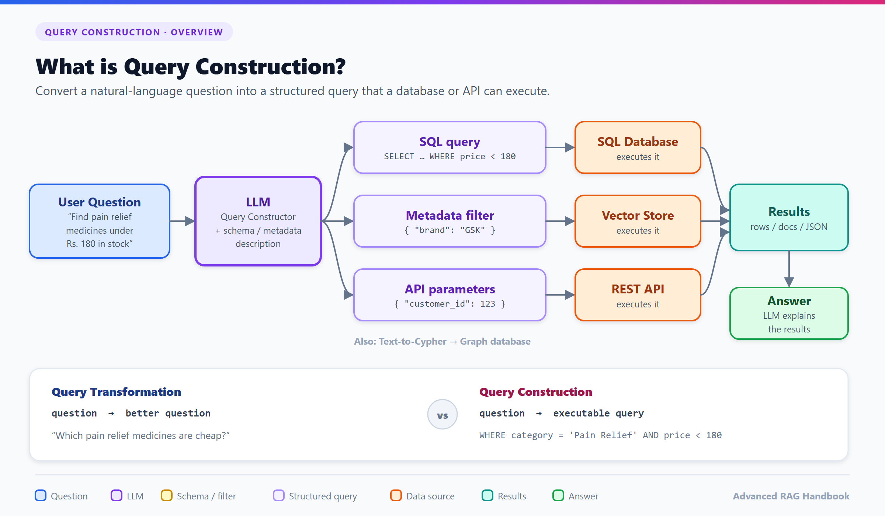
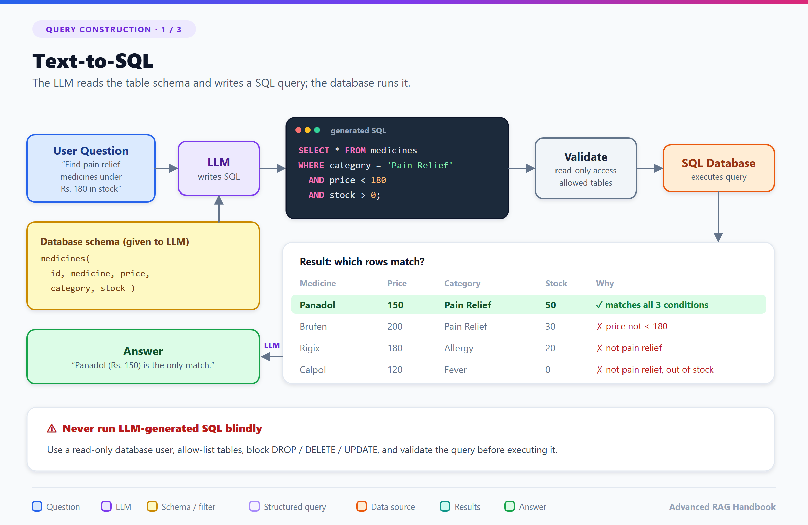
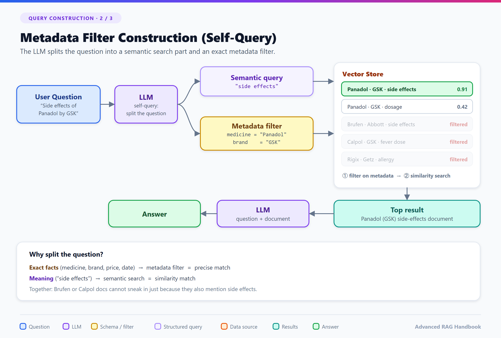
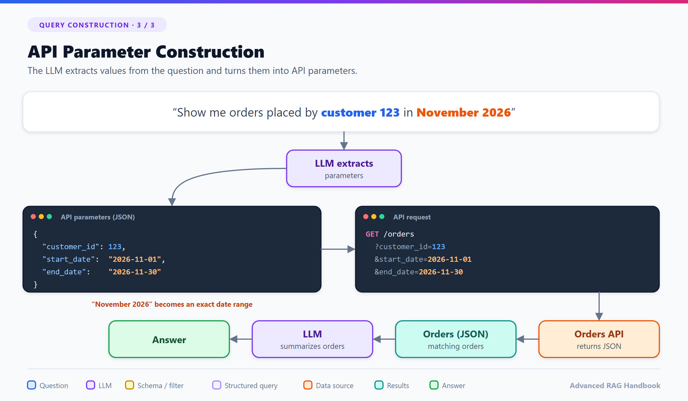
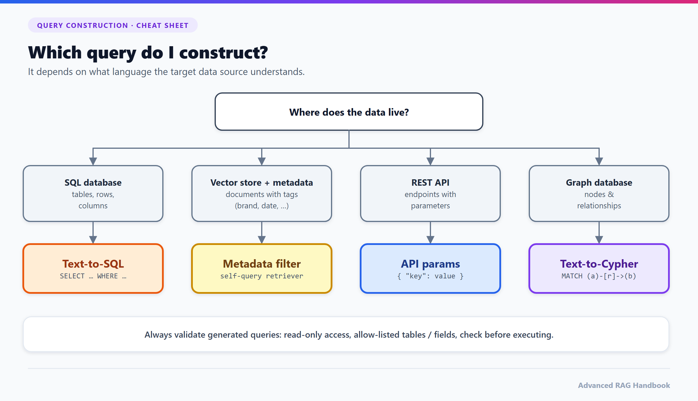

# Query Construction in RAG

> Interview prep notes: concepts, definitions, diagrams, and trade-offs.

---

## What is Query Construction?

**Interview definition:**
> Query Construction is a technique in RAG where an LLM converts a user's **natural-language question** into a **structured query** (such as SQL, a metadata filter, or API parameters) that a database or retrieval system can **understand and execute**.

**In simple words:** the user asks in plain English, and the system translates it into the "language" of the data source.

**Why do we need it?**

Not all data is unstructured text. A lot of real data is **structured**: tables, tagged documents, APIs. Embedding similarity alone can't answer questions like *"medicines under Rs. 180 that are in stock"*. That needs **exact conditions** (`price < 180`, `stock > 0`), and only a structured query can apply them.

**Core flow:**
`Natural language → LLM (Query Constructor) → Structured query → Database / API executes it → Results → LLM → Answer`



**Types of Query Construction:**

| # | Type | Natural language becomes… | Target |
|---|------|---------------------------|--------|
| 1 | Text-to-SQL | A SQL query | Relational / SQL database |
| 2 | Metadata Filter Construction (Self-Query) | A metadata filter + a semantic query | Vector database |
| 3 | API Parameter Construction | API parameters (JSON / query string) | REST API |
| + | Text-to-Cypher | A Cypher query | Graph database (e.g. Neo4j) |

---

## Example Data (used throughout)

A medical e-commerce `medicines` table:

| ID | Medicine | Price | Category | Stock |
|----|----------|-------|----------|-------|
| 1 | Panadol | 150 | Pain Relief | 50 |
| 2 | Brufen | 200 | Pain Relief | 30 |
| 3 | Rigix | 180 | Allergy | 20 |
| 4 | Calpol | 120 | Fever | 0 |

---

## 1. Text-to-SQL

### Interview definition
> Text-to-SQL is a query construction technique where an LLM, given the **database schema**, converts a natural-language question into an **executable SQL query**. The database runs it and returns exact results.

### Simple explanation
The LLM is shown the table structure (table names, columns, types). It reads the question, works out the conditions, and writes SQL. The database does the actual filtering, so results are **exact**, not "similar".

**Example:** *"Find pain relief medicines under Rs. 180 that are in stock."*

```sql
SELECT * FROM medicines
WHERE category = 'Pain Relief'
  AND price < 180
  AND stock > 0;
```

Result → **Panadol (Rs. 150, 50 in stock)**. Brufen is too expensive, Rigix isn't pain relief, and Calpol isn't pain relief and is out of stock.

### Diagram


### How it works
1. User asks a question in natural language.
2. LLM receives the question + **database schema**.
3. LLM generates a SQL query.
4. Application **validates** the query (read-only, allowed tables, no destructive commands).
5. Database executes the query and returns rows.
6. LLM turns the rows into a natural-language answer.

> In LangChain: `create_sql_query_chain(llm, db)` generates SQL from a question, using `SQLDatabase.from_uri(...)` for the schema.

### When to use
- Data lives in **SQL databases** (products, orders, employees, finance).
- Questions need **exact filters, counts, sums, sorting** ("how many", "average", "top 5").
- Users who don't know SQL need to query complex data.

### Advantages
- **Exact, precise answers**: the database applies the conditions.
- Handles aggregations (COUNT, SUM, AVG, GROUP BY) that vector search can't do.
- No need to embed structured data.

### Limitations
- LLM can write **wrong SQL** (wrong column, wrong join, wrong logic).
- **Security risk**: SQL injection, or destructive queries (DROP / DELETE).
- Large or complex schemas confuse the LLM, and putting the whole schema in the prompt costs tokens.

> ⚠️ **Never execute LLM-generated SQL blindly.** Use a read-only DB user, allow-list tables, block DROP / DELETE / UPDATE, and validate before running.

---

## 2. Metadata Filter Construction (Self-Query)

### Interview definition
> Metadata filter construction is a query construction technique where an LLM converts a question into a **metadata filter** (exact conditions on document tags like brand, date, or category), usually together with a **semantic search query**. The vector database first filters by metadata, then runs similarity search on the remaining documents.

### Simple explanation
Documents in a vector store often carry **metadata** (tags):

```json
{ "medicine": "Panadol", "category": "Pain Relief", "brand": "GSK", "price": 150 }
```

When a user asks *"What are the side effects of Panadol from GSK?"*, the question contains **two kinds of information**:

| Part of the question | Becomes | Matching type |
|----------------------|---------|---------------|
| "side effects" (meaning) | **Semantic query** | Similarity search |
| "Panadol", "GSK" (exact facts) | **Metadata filter**: `medicine = "Panadol" AND brand = "GSK"` | Exact match |

The LLM **splits** the question. This is why LangChain calls it a **Self-Query Retriever**: the retriever writes its own query.

**Why it matters:** without the filter, a Brufen or Calpol document that also talks about "side effects" might score high on similarity and sneak into the results. The filter removes them before similarity search.

### Diagram


### How it works
1. Describe the available metadata fields to the LLM (name, type, meaning).
2. User asks a question.
3. LLM splits it into a **semantic query** + a **metadata filter**.
4. Vector database applies the **filter** (keeps only matching documents).
5. Runs **similarity search** on the filtered documents with the semantic query.
6. Top documents + question go to the LLM for the final answer.

> In LangChain: `SelfQueryRetriever.from_llm(llm, vectorstore, document_content_description, metadata_field_info)`, where `metadata_field_info` is a list of `AttributeInfo` describing each field.

### When to use
- Vector store documents have **useful metadata** (brand, date, author, category, price).
- Questions mix **meaning** and **exact constraints** ("2024 reports about revenue", "GSK docs about dosage").
- You want **hybrid** retrieval: semantic + exact filtering.

### Advantages
- **More precise retrieval**: irrelevant documents are filtered out before search.
- Combines the strengths of **semantic search** and **exact filtering**.
- Works with filters most vector DBs already support (Chroma, Pinecone, Qdrant, etc.).

### Limitations
- Depends on **good, consistent metadata**. Missing or messy tags break it.
- LLM may build a **wrong or too-strict filter**, which returns zero results.
- Filter syntax differs between vector databases (needs a translator layer).

---

## 3. API Parameter Construction

### Interview definition
> API parameter construction is a query construction technique where an LLM **extracts values from a natural-language question** and converts them into **structured API parameters**, so the application can call an external or internal API.

### Simple explanation
Many systems are only reachable through APIs (orders, weather, CRM, payments). The LLM reads the question, finds the important values, **normalizes** them into the exact format the API expects, and the app makes the call.

**Example:** *"Show me orders placed by customer 123 in November 2026."*

```json
{
  "customer_id": 123,
  "start_date": "2026-11-01",
  "end_date": "2026-11-30"
}
```

→ `GET /orders?customer_id=123&start_date=2026-11-01&end_date=2026-11-30`

Note how *"November 2026"* (vague) becomes an **exact date range**. Resolving values like this is a key part of the LLM's job.

### Diagram


### How it works
1. Define the API's parameters (names, types, formats) for the LLM. This is usually a tool / function schema.
2. User asks a question.
3. LLM extracts values and returns them as **structured parameters**.
4. Application validates the parameters and calls the API.
5. API returns data (usually JSON).
6. LLM summarizes the response into an answer.

### When to use
- Data is only available through **APIs** (internal services, third-party platforms).
- Live / real-time data (orders, weather, stock prices).
- Same idea as LLM **function / tool calling**.

### Advantages
- Lets users query APIs **in plain language**.
- Access to **live data** that isn't in your vector store.
- Structured output is easy to validate (types, required fields).

### Limitations
- LLM may **extract wrong values** or misread dates ("last month", time zones).
- API errors, rate limits, and latency are outside your control.
- Must validate parameters to avoid unintended or unauthorized calls.

---

## Bonus: Text-to-Cypher (Graph Databases)

> **Text-to-Cypher** converts a natural-language question into a **Cypher query** for a graph database like Neo4j, where data is stored as **nodes and relationships**.

*"Which medicines does GSK manufacture?"* →
```cypher
MATCH (b:Brand {name: "GSK"})-[:MANUFACTURES]->(m:Medicine)
RETURN m.name
```

Use it when the question is about **relationships** (who is connected to what). It's the same idea as Text-to-SQL, just for graphs.

---

## Comparison

### All types

| Feature | Text-to-SQL | Metadata Filter (Self-Query) | API Parameters | Text-to-Cypher |
|---------|-------------|------------------------------|----------------|----------------|
| Output | SQL query | Filter + semantic query | JSON / query params | Cypher query |
| Target | SQL database | Vector database | REST API | Graph database |
| Matching | Exact | Exact filter + similarity | Exact | Exact (graph patterns) |
| Example | `WHERE price < 180` | `brand = "GSK"` + "side effects" | `customer_id=123` | `MATCH (a)-[r]->(b)` |
| Main risk | Wrong / unsafe SQL | Wrong or too-strict filter | Wrong extracted values | Wrong graph pattern |

### Query Construction vs Query Transformation (often asked)

| | Query Transformation | Query Construction |
|--|----------------------|--------------------|
| What it produces | A **better natural-language question** | An **executable structured query** |
| Goal | Improve **retrieval** from vector stores | Talk to **structured** data sources |
| Examples | Multi-Query, Decomposition, Step-Back, HyDE | Text-to-SQL, metadata filters, API params |
| Example output | "Which pain relief medicines are cheap?" | `WHERE category = 'Pain Relief' AND price < 180` |

**One-liner:** *Transformation rewrites the question. Construction translates it into a query language.*

### Where it fits in the RAG pipeline
`Query Transformation (improve the question) → Routing (pick the source) → Query Construction (speak the source's language) → Retrieval → Generation`

---

## Which One Should I Pick?



**Rule of thumb:** pick based on **where the data lives**.
- Tables / rows / columns → **Text-to-SQL**
- Documents with tags in a vector store → **Metadata filter (Self-Query)**
- Data behind an API → **API parameters**
- Nodes and relationships → **Text-to-Cypher**

For all of them, **validate generated queries before executing**.

---

## 30-Second Revision

- **Query Construction** = natural language → structured query → database / API executes it → results → answer.
- **Text-to-SQL** = LLM + schema → SQL. Exact results. Never run it blindly (read-only, validate).
- **Metadata filter / Self-Query** = split the question into a **semantic part** ("side effects") and an **exact filter** (`brand = "GSK"`). Filter first, then similarity search.
- **API params** = extract values ("customer 123", "November 2026") → `{customer_id: 123, start_date, end_date}` → call the API.
- **Text-to-Cypher** = same idea for graph databases.
- **vs Query Transformation**: transformation = better question. Construction = executable query.
