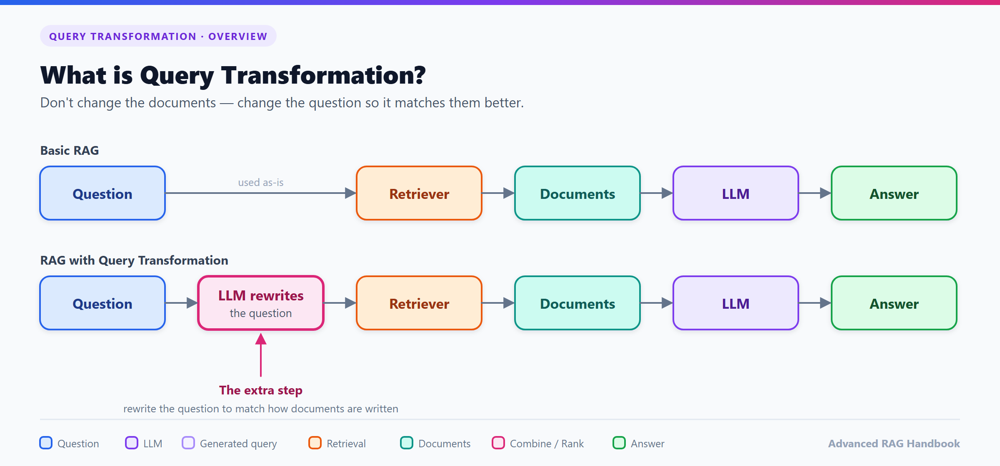
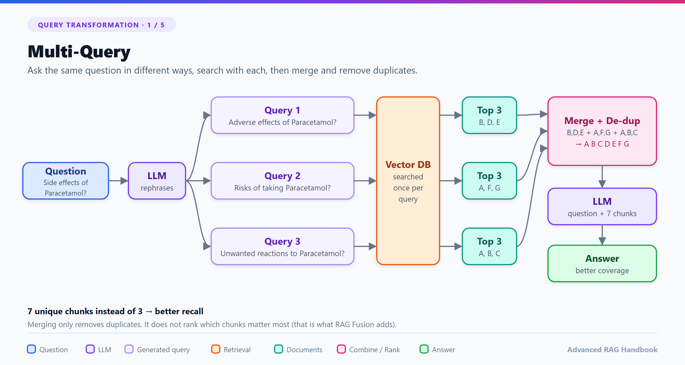
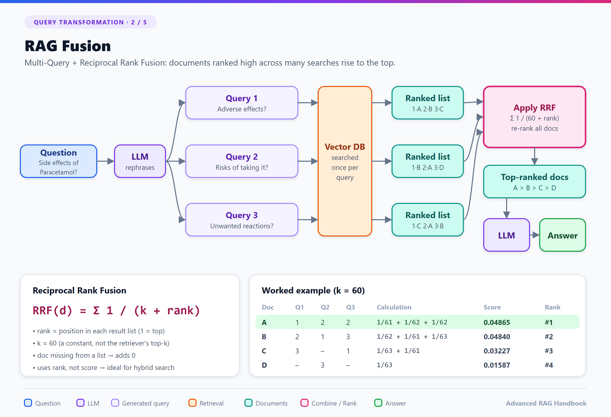
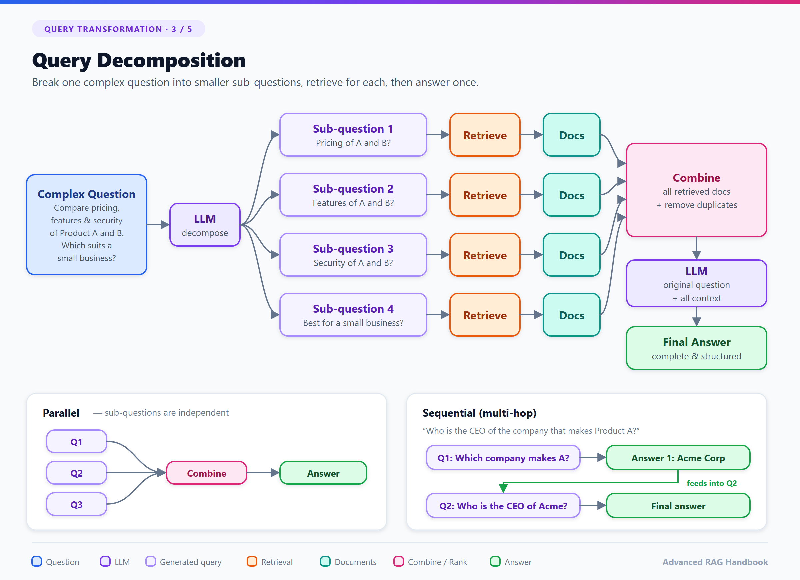
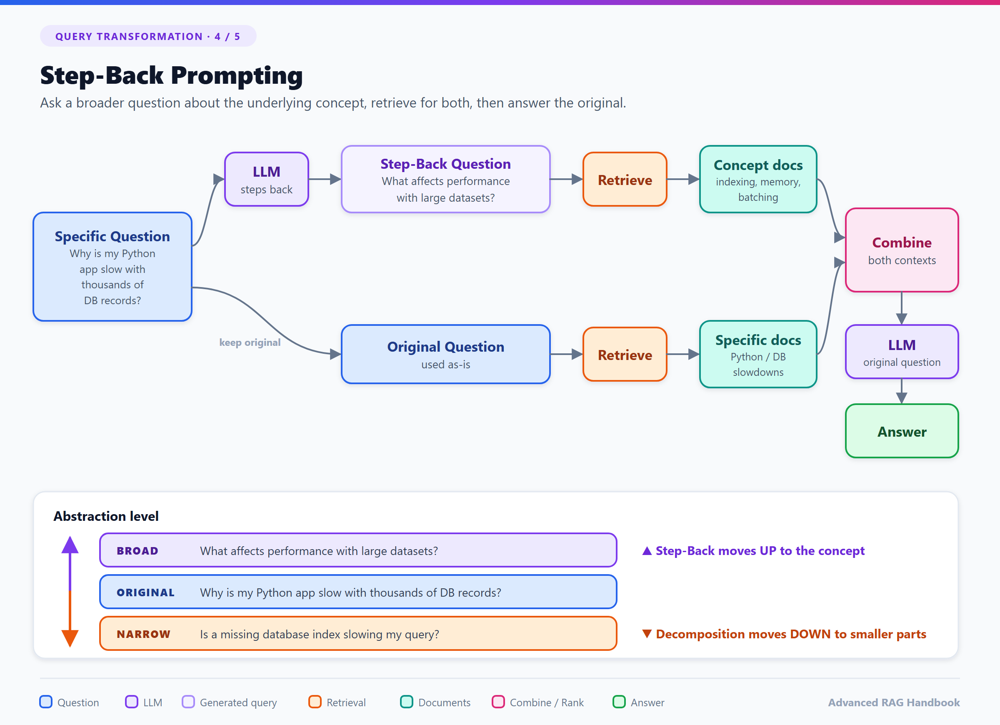
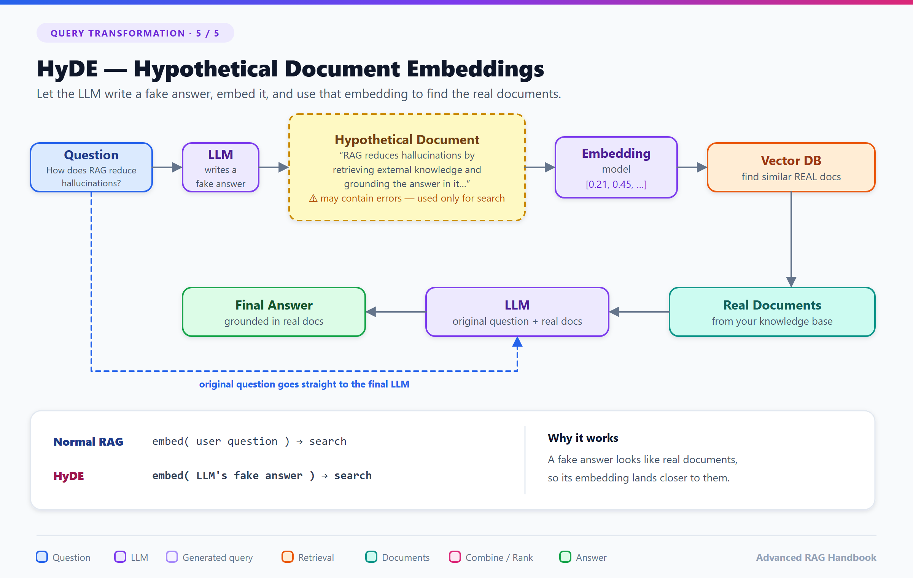
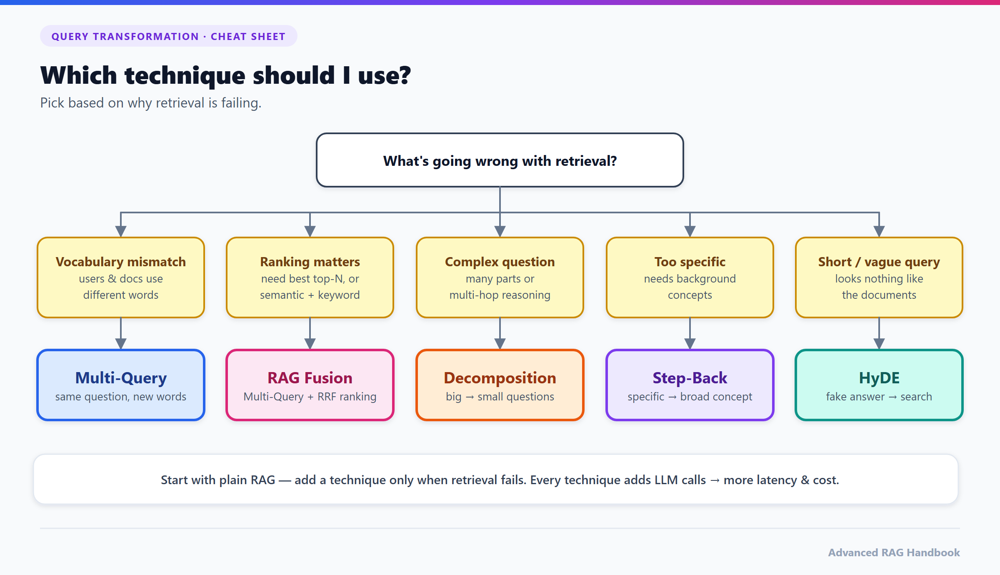

# Query Transformation in RAG

> Interview prep notes — concepts, definitions, diagrams, and trade-offs.

---

## What is Query Transformation?

**Interview definition:**
> Query Transformation is a set of techniques in RAG where an LLM rewrites, expands, or restructures the user's question **before retrieval**, so that the retriever finds more relevant documents.

**Why do we need it?**

In basic RAG, we embed the user's question as-is and search the vector database. This fails when:

- The user's **wording differs** from the documents' wording ("side effects" vs "adverse reactions").
- The question is **too complex** (multiple parts) for one search.
- The question is **too specific** and the database has no direct match.
- The question is **too short** to carry enough meaning for a good embedding.

**Core idea:** *Don't change the documents — change the question so it matches the documents better.*



**The 5 techniques at a glance:**

| # | Technique | One-line idea |
|---|-----------|---------------|
| 1 | Multi-Query | Ask the **same question in different ways** |
| 2 | RAG Fusion | Multi-Query **+ re-rank results with RRF** |
| 3 | Query Decomposition | Break **one big question into smaller ones** |
| 4 | Step-Back Prompting | Ask a **broader, more general** question first |
| 5 | HyDE | Write a **fake answer**, search using its embedding |

---

## 1. Multi-Query

### Interview definition
> Multi-Query is a query transformation technique where an LLM generates **multiple rephrased versions** of the user's question. Each version is used to search the vector database, and the results are **merged and de-duplicated** to improve retrieval coverage.

### Simple explanation
A single query might not retrieve all relevant chunks, because documents may use different words for the same idea. So we ask the same question in several ways and collect everything they find.

**Example:** User asks *"What are the side effects of Paracetamol?"*
The documents say things like *"adverse effects of Paracetamol"*, *"reactions to Acetaminophen"*, *"risks of taking Paracetamol"*.

The LLM generates:
- Q1: What adverse effects can Paracetamol cause?
- Q2: What are the risks of taking Paracetamol?
- Q3: What unwanted reactions are associated with Paracetamol?

### Diagram


### How it works
1. User asks a question.
2. LLM generates 3–5 alternative versions of the question.
3. Each version (often plus the original) searches the vector DB separately.
4. All results are merged and **duplicates are removed**.
5. Unique chunks + original question go to the LLM for the final answer.

**Mini example:** 3 queries × top-3 chunks each →
`A,B,C + B,D,E + A,F,G` → after de-dup → `A,B,C,D,E,F,G` (7 unique chunks instead of 3).

### When to use
- Users and documents use **different vocabulary** for the same concept.
- Single-query retrieval is **missing relevant chunks** (low recall).
- Queries are ambiguous and can be read in multiple ways.

### Advantages
- **Better recall** — finds chunks a single query would miss.
- Covers **different perspectives and terminology**.
- Simple to implement (LangChain has `MultiQueryRetriever`).

### Limitations
- Extra LLM call + multiple vector searches → **higher latency and cost**.
- **No ranking** — all merged chunks are treated equally.
- More chunks ≠ better answers; irrelevant chunks can add noise and tokens.

---

## 2. RAG Fusion (Reciprocal Rank Fusion)

### Interview definition
> RAG Fusion is a query transformation technique where an LLM generates multiple variations of the query, each variation retrieves documents independently, and the results are combined and **re-ranked using Reciprocal Rank Fusion (RRF)**, which rewards documents that rank highly across many searches.

### Simple explanation
RAG Fusion is an **improved version of Multi-Query**. Multi-Query just merges the results. RAG Fusion also asks: *"Which documents kept showing up near the top in most searches?"* — and puts those first.

It uses the **rank position** of each document in each result list, not the similarity score.

### The RRF formula

```
              ┌                   ┐
 RRF(d) =  Σ  │      1            │
          r∈R │ ───────────────── │
              │  k + rank_r(d)    │
              └                   ┘
```

- `d` = a document
- `R` = all the result lists (one per query)
- `rank_r(d)` = position of `d` in list `r` (1 = top)
- `k` = constant, usually **60** (this is NOT the "top-k" of the retriever)

If a document is missing from a list, it gets 0 from that list.

### Worked example (k = 60)

| Document | Q1 rank | Q2 rank | Q3 rank | RRF score | Final rank |
|----------|---------|---------|---------|-----------|------------|
| A | 1 | 2 | 2 | 1/61 + 1/62 + 1/62 = **0.04865** | 🥇 1 |
| B | 2 | 1 | 3 | 1/62 + 1/61 + 1/63 = **0.04840** | 2 |
| C | 3 | – | 1 | 1/63 + 1/61 = **0.03227** | 3 |
| D | – | 3 | – | 1/63 = **0.01587** | 4 |

**A wins** because it appears near the top **consistently** across all searches.

### Diagram


### How it works
1. LLM generates multiple query variations.
2. Each query retrieves its own **ranked** list of documents.
3. RRF calculates a score per document from its rank positions.
4. Documents are re-sorted by RRF score; keep the top N.
5. Top documents + original question go to the LLM.

### Why RRF uses rank, not score (important interview point)
Different retrievers produce scores on **different scales** — e.g. vector search gives cosine similarity (0–1), BM25 keyword search gives unbounded scores. You can't add them directly. But **rank positions are always comparable**. That's why RRF is popular for **Hybrid Search** (semantic + keyword search).

### When to use
- Same situations as Multi-Query, **but you also care about ordering** (you only pass top-N docs to the LLM).
- Combining results from **different retrievers** (semantic + keyword-based search).

### Advantages
- Improves **recall and ranking** together.
- Documents relevant across many phrasings rise to the top → less noise.
- Score-scale independent; simple formula, no extra model needed.

### Limitations
- Same cost/latency as Multi-Query (extra LLM call + multiple searches).
- Ignores how strong a match was — only position matters.
- If generated queries drift off-topic, wrong documents can still be boosted.

### Multi-Query vs RAG Fusion

| Feature | Multi-Query | RAG Fusion |
|---------|-------------|------------|
| Generates alternative queries | ✅ | ✅ |
| Searches multiple times | ✅ | ✅ |
| Merges results | ✅ (de-dup only) | ✅ |
| Re-ranks using RRF | ❌ | ✅ |
| Goal | Better **recall** | Better **recall + ranking** |

---

## 3. Query Decomposition

### Interview definition
> Query Decomposition is a query transformation technique where a **complex question is broken down into smaller, simpler sub-questions**. Each sub-question is retrieved separately, and the retrieved context is combined to generate one comprehensive answer.

### Simple explanation
A complex question has many parts, and a single search can't find information for all of them. So we split it into focused sub-questions, each of which finds its own relevant documents.

**Example:** *"Compare the pricing, features, and security of Product A and Product B, and explain which is better for a small business."*

Sub-questions:
1. What are the pricing plans of Product A?
2. What are the pricing plans of Product B?
3. What are the main features of Product A?
4. What are the main features of Product B?
5. What security features do both products offer?
6. Which product suits a small business?

**Key difference from Multi-Query:** Multi-Query asks the **same** question differently. Decomposition asks **different** smaller questions.

### Diagram


**Two styles:** **Parallel** when sub-questions are independent; **Sequential** when one depends on another's answer.
Example of sequential (multi-hop): *"Who is the CEO of the company that makes Product A?"* → first find the company, then find its CEO.

### How it works
1. LLM breaks the question into sub-questions.
2. Each sub-question retrieves its own documents (in parallel or sequentially).
3. Retrieved documents are combined and de-duplicated.
4. **Original question** + all context is passed to the LLM.
5. LLM generates one comprehensive answer.

### When to use
- Questions with **multiple parts** (compare X and Y on A, B, C).
- Information spread across **different documents**.
- **Multi-hop reasoning** — one answer depends on another.
- Research and comparison applications.

### Advantages
- Each sub-question gets **focused, precise** retrieval.
- Handles complex and multi-hop questions that one search can't.
- Final answer is more complete and structured.

### Limitations
- Many LLM calls + many searches → **highest cost and latency** of these techniques.
- Bad decomposition = **missed information**.
- Too many sub-questions → irrelevant context.
- Dependent sub-questions need **sequential** retrieval (slower).
- Overkill for simple questions.

---

## 4. Step-Back Prompting

### Interview definition
> Step-Back Prompting is a query transformation technique where an LLM takes a **specific, detailed question** and first generates a **broader, more general question** about the underlying concept. Documents are retrieved for both the broad and the original question, and the combined context helps the LLM answer the original question more accurately.

### Simple explanation
Sometimes a question is so specific that the database has no direct match. So we "take a step back" and ask about the **general concept** behind it. The fundamental knowledge retrieved helps answer the specific question.

**Decomposition goes down (smaller pieces). Step-Back goes up (bigger concept).**

**Example:**
- Specific: *"Why does my Python application become slow when processing thousands of database records?"*
- Step-back: *"What factors affect application performance when processing large datasets?"*
- Retrieves: database indexing, memory management, query optimization, batch processing, time complexity.
- The LLM uses this background knowledge to explain the specific problem.

### Diagram


### How it works
1. User asks a specific question.
2. LLM generates a broader step-back question.
3. Retrieve documents using the step-back question.
4. Retrieve documents using the original question too.
5. Combine both contexts.
6. Pass combined context + **original question** to the LLM.

### When to use
- Question is **too specific** / no direct match in the DB.
- The answer needs **background knowledge or principles**.
- Technical troubleshooting, science/reasoning questions.

### Advantages
- Retrieves **fundamental concepts** that direct search misses.
- Gives the LLM context to **reason** instead of guess.
- Only one extra LLM call (cheaper than Decomposition).

### Limitations
- If the broad question is **too general**, it retrieves irrelevant content.
- Extra LLM call → added latency/cost.
- Not helpful for simple fact lookups ("What is the price of Product A?").

---

## 5. HyDE (Hypothetical Document Embeddings)

### Interview definition
> HyDE is a query transformation technique where an LLM first generates a **hypothetical answer (document)** to the user's question. That hypothetical document is converted into an **embedding** and used to search the vector database, instead of the question's embedding. The final answer is generated from the **real retrieved documents**.

### Simple explanation
Questions and answers look different. A question is short (*"How does RAG reduce hallucinations?"*); documents are long, detailed explanations. Their embeddings may not be close.

HyDE's trick: **answer-to-answer similarity is stronger than question-to-answer similarity.** So the LLM writes a fake answer that *looks like* the documents we want, and we search with that.

**Example:**
- Question: *"How does RAG reduce hallucinations in LLMs?"*
- LLM writes hypothetical doc: *"RAG reduces hallucinations by retrieving relevant information from external knowledge sources and providing it as context to the model, grounding the response in evidence..."*
- Embed this text → search vector DB → get real documents about grounding and retrieval.

### Diagram


### How it works
1. User asks a question.
2. LLM generates a hypothetical answer/document.
3. Embedding model converts the hypothetical document into a vector.
4. Vector DB finds real documents similar to that vector.
5. **Original question** + real retrieved docs → LLM → final answer.

**Important:** the hypothetical document is **only used for searching**. It is discarded afterwards; it is never given to the LLM as a fact.

### When to use
- Original query is **short** or lacks context.
- **Vocabulary gap** between user questions and technical documents.
- Questions where the LLM has general knowledge of what a good answer looks like.

### Advantages
- Bridges the **vocabulary gap** — improves semantic matching.
- Works well for short or vague queries.
- Only one extra LLM call; no extra training needed.

### Limitations
- Extra LLM call → added latency/cost.
- Hypothetical doc may contain **wrong information** (hallucination) → can retrieve wrong docs.
- Weak for very **domain-specific / private** topics the LLM knows nothing about (e.g. internal company data) — the fake answer will be off.

---

## Comparison: All 5 Techniques

| Technique | What the LLM generates | What is searched | Main goal | Extra cost |
|-----------|------------------------|------------------|-----------|------------|
| **Multi-Query** | Several rephrasings of the same question | Each rephrasing | Recall (find more) | Medium |
| **RAG Fusion** | Several rephrasings of the same question | Each rephrasing, then RRF re-rank | Recall + ranking | Medium |
| **Decomposition** | Smaller, different sub-questions | Each sub-question | Handle complex / multi-part questions | High |
| **Step-Back** | One broader, conceptual question | Broad question + original | Get background knowledge | Low |
| **HyDE** | A hypothetical answer/document | Embedding of the fake answer | Bridge question ↔ document gap | Low |

### Easy-to-confuse pairs

| Pair | The difference |
|------|----------------|
| Multi-Query vs RAG Fusion | RAG Fusion adds **RRF re-ranking**; Multi-Query only merges + de-duplicates. |
| Multi-Query vs Decomposition | Multi-Query = **same** question, different words. Decomposition = **different, smaller** questions. |
| Decomposition vs Step-Back | Decomposition goes **down** (smaller parts). Step-Back goes **up** (broader concept). |
| Step-Back vs HyDE | Step-Back generates a broader **question**. HyDE generates a hypothetical **answer**. |

**Same example, five techniques** — *"Why is my RAG chatbot returning irrelevant documents?"*

- **Multi-Query:** "Why does my RAG system retrieve wrong chunks?", "What causes poor retrieval in RAG?"…
- **RAG Fusion:** same rephrasings → results re-ranked with RRF.
- **Decomposition:** "Is chunking the problem?", "Are embeddings the problem?", "Is reranking needed?"
- **Step-Back:** "What factors determine retrieval quality in semantic search systems?"
- **HyDE:** writes a fake paragraph: "Irrelevant retrieval is usually caused by poor chunk size, weak embeddings…" → searches with it.

---

## Which One Should I Pick?



**Rule of thumb:**
- Start with **plain RAG**. Add a technique only when retrieval is failing.
- Vocabulary mismatch → **Multi-Query** (or **RAG Fusion** if you need good top-N ordering).
- Complex / comparison / multi-hop → **Decomposition**.
- Specific question needing concepts → **Step-Back**.
- Short query vs long technical docs → **HyDE**.
- Every technique adds **LLM calls → latency and cost**. That's the main trade-off to mention in interviews.

---

## 30-Second Revision

- **Query Transformation** = rewrite the question before retrieval so it matches the documents better.
- **Multi-Query** = ask the same question in different ways → merge + de-dup.
- **RAG Fusion** = Multi-Query + **RRF**: `score = Σ 1/(k + rank)`, k = 60 → docs ranked high across many searches win. Great for hybrid (semantic + keyword) search.
- **Decomposition** = one big question → many small questions (parallel or sequential).
- **Step-Back** = specific question → broader concept question → retrieve both.
- **HyDE** = write a fake answer → embed it → search with it → answer from **real** docs only.
