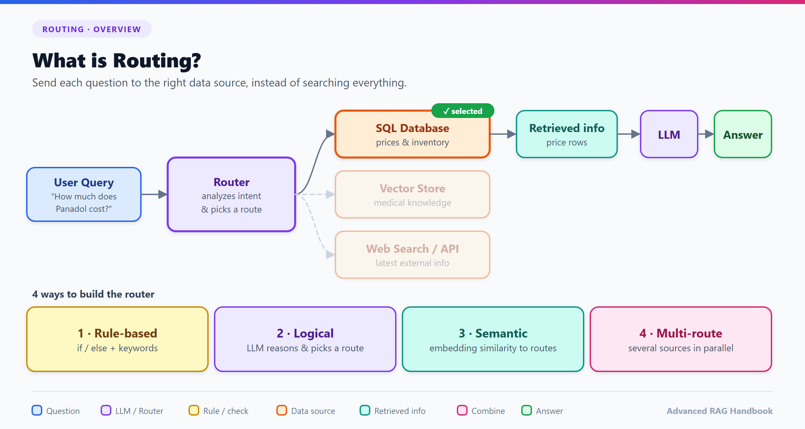
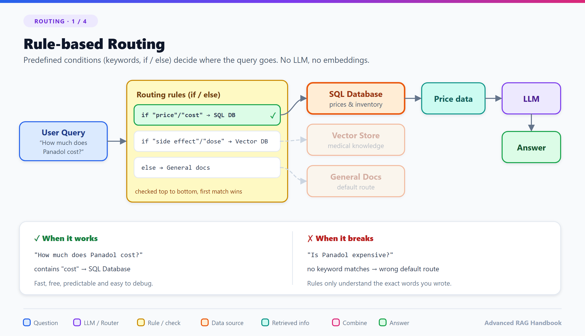
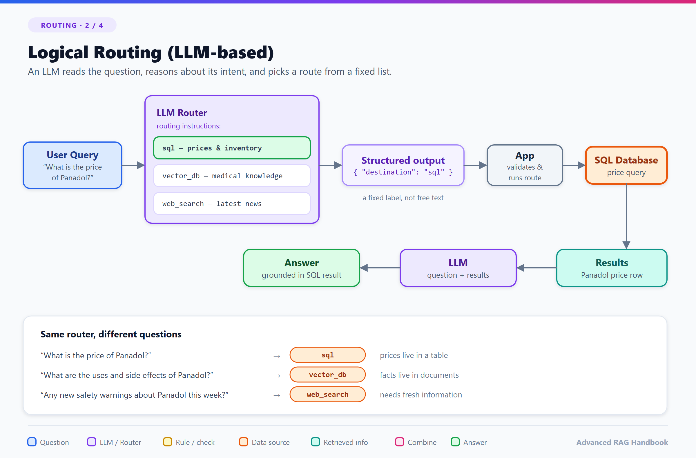
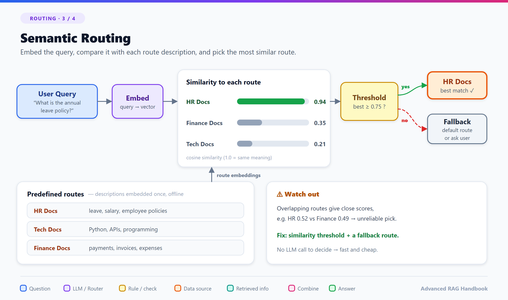
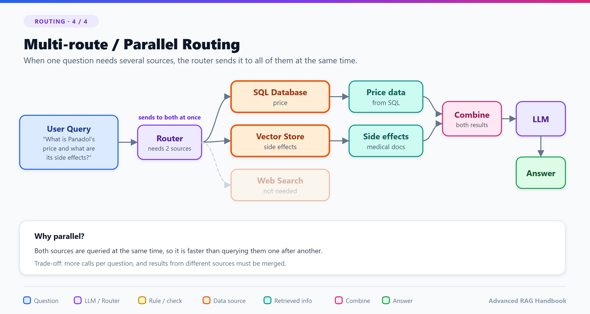
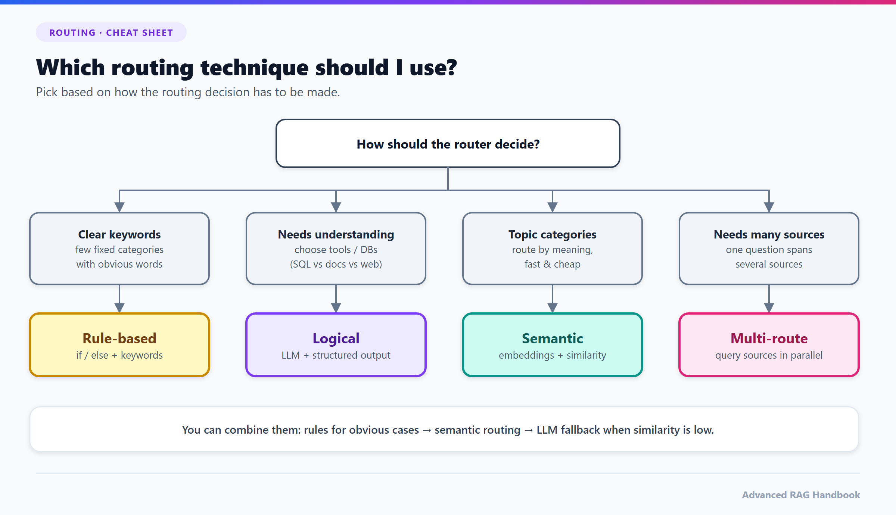

# Routing in RAG

> Interview prep notes: concepts, definitions, diagrams, and trade-offs.

---

## What is Routing?

**Interview definition:**
> Routing is the step in a RAG pipeline where a **router analyzes the user's query and decides which data source, retriever, tool, or prompt should handle it**, so the query goes only to the place most likely to have the answer.

**Why do we need it?**

Real applications rarely have just one vector store. Data is usually spread across:

- a **vector store** (documents, manuals, policies)
- a **SQL database** (prices, inventory, structured records)
- **web search / APIs** (fresh, external information)
- several **topic-specific** indexes (HR docs, tech docs, finance docs)

Searching everything for every question is slow, expensive, and pulls in irrelevant context. A router sends each question to the **right** place.

**Core flow:**
`User Query → Router (analyze intent) → Selected source → Retrieved info → LLM → Final answer`

**The 4 routing techniques at a glance:**

| # | Technique | How the router decides |
|---|-----------|------------------------|
| 1 | Rule-based Routing | Predefined **if / else conditions and keywords** |
| 2 | Logical Routing | An **LLM reasons** about the query and picks a route |
| 3 | Semantic Routing | **Embedding similarity** between the query and route descriptions |
| 4 | Multi-route / Parallel Routing | Sends the query to **several sources at once** |

> **Note on naming:** Some sources (e.g. LangChain's *RAG from Scratch*) only name two types: **Logical** and **Semantic**. In that view, rule-based routing counts as a simple form of logic-based routing. Both views are correct. Just explain which one you're using.

---

## 1. Rule-based Routing

### Interview definition
> Rule-based routing uses **predefined conditions**, such as keywords, regex patterns, or if / else logic, to decide where a query should go. No LLM and no embeddings are involved.

### Simple explanation
You write the rules yourself. The system checks the query against them, from top to bottom, and the first rule that matches decides the route. If nothing matches, a **default route** is used.

**Example:**
- Rule 1: query contains *"price"* or *"cost"* → **SQL database**
- Rule 2: query contains *"side effect"* or *"dose"* → **Medical vector store**
- Else → **General docs**

*"How much does Panadol cost?"* contains *"cost"* → SQL database ✓
*"Is Panadol expensive?"* matches no keyword → wrong default route ✗

### Diagram

### How it works
1. Define rules (keywords / patterns → destination) and a default route.
2. Receive the user query.
3. Check the query against each rule in order.
4. The first matching rule selects the source.
5. Retrieve from that source.
6. Pass query + retrieved info to the LLM for the final answer.

### When to use
- A **small, fixed** set of categories with **obvious keywords**.
- When routing must be **predictable, auditable, and free** (no extra model calls).
- As a fast **first layer** before smarter routing.

### Advantages
- **Fastest and cheapest**: no LLM or embedding calls.
- **Predictable and easy to debug**: you know exactly why a route was chosen.

### Limitations
- **Brittle**: fails on synonyms and new wording ("expensive" vs "price").
- Rules grow messy and hard to maintain as categories increase.
- Doesn't understand meaning, only exact words.

---

## 2. Logical Routing (LLM-based)

### Interview definition
> Logical routing uses an **LLM to analyze the meaning and intent** of the user's query and choose a destination (data source, retriever, or tool) from a **predefined list of options**, usually returned as **structured output**.

### Simple explanation
Instead of writing keyword rules, you describe each route to the LLM ("SQL = prices and inventory", "Vector DB = medical knowledge", "Web search = latest news"). The LLM reads the question, **reasons** about what it needs, and returns a fixed label like `{"destination": "sql"}`. Your application then runs that route.

**Example:**
- *"What is the price of Panadol?"* → `sql` (prices live in a table)
- *"What are the uses and side effects of Panadol?"* → `vector_db` (facts live in documents)
- *"Any new safety warnings about Panadol this week?"* → `web_search` (needs fresh info)

**Why structured output?** The LLM must return **one of the allowed labels**, not free text. This makes the decision reliable and easy for code to act on. In LangChain this is done with `llm.with_structured_output(...)` and a Pydantic model whose field is a `Literal["sql", "vector_db", "web_search"]`.

### Diagram

### How it works
1. Receive the user query.
2. Send it to an LLM with **routing instructions** (the list of routes + what each one is for).
3. LLM analyzes intent and returns a **structured decision** (one allowed label).
4. Application **validates** the decision.
5. Execute the selected route: SQL query, retriever, or API call.
6. Pass query + results to the LLM to generate the final answer.

### When to use
- Choosing between **different kinds of sources or tools** (SQL vs vector DB vs web).
- The decision needs **understanding**, not just keyword matching.
- Routes are hard to describe with simple rules.

### Advantages
- **Understands meaning and intent**, so it handles new wording well.
- **Flexible**: add a route by adding one line to the instructions.
- Handles **complex, multi-condition** decisions.

### Limitations
- An **extra LLM call** for every query, which adds latency and cost.
- LLM can still **pick the wrong route** (non-deterministic), so validate the output and have a fallback.
- Quality depends on how clearly the routes are described in the prompt.

---

## 3. Semantic Routing

### Interview definition
> Semantic routing **embeds the user's query** and compares it, using similarity search, with the **embeddings of predefined route descriptions** (or example queries). The route with the **highest similarity score** is selected.

### Simple explanation
Each route gets a short description or a few example questions, embedded **once** ahead of time. At query time you embed the question, compute cosine similarity against every route, and pick the closest one. **No LLM is needed to make the decision.**

**Example:** *"What is the annual leave policy?"*

| Route | Description | Similarity |
|-------|-------------|------------|
| **HR Docs** | leave, salary, employee policies | **0.94** ✓ |
| Finance Docs | payments, invoices, expenses | 0.35 |
| Tech Docs | Python, APIs, programming | 0.21 |

→ Routed to the **HR vector store**.

**Threshold + fallback (from my notes):** Similarity can be **misleading when categories overlap** (e.g. HR 0.52 vs Finance 0.49). So set a **minimum similarity threshold**. If the best score is below it, send the query to a **fallback route** (a default source, an LLM router, or ask the user to clarify).

**Note:** The destination doesn't have to be a data source. In LangChain's example, semantic routing picks a **prompt template** (e.g. a "physics expert" prompt vs a "math expert" prompt) based on similarity to the question.

### Diagram

### How it works
1. Define routes with descriptions or example queries.
2. Embed each route description (once, offline).
3. Receive the user query and embed it.
4. Compute similarity between the query and every route.
5. If the best score ≥ threshold → select that route. Otherwise → fallback route.
6. Retrieve from the selected source and generate the answer.

### When to use
- **Topic / intent-based** routing with clear categories (HR vs Tech vs Finance).
- You need routing that is **fast and cheap** but smarter than keywords.
- High query volume where an LLM call per query is too expensive.

### Advantages
- **Fast and cheap**: one embedding call plus a similarity calculation, no LLM.
- Understands **meaning**, not just exact words (handles synonyms).
- Easy to add routes: just add a description or examples.

### Limitations
- **Fuzzy**: struggles when categories **overlap** or descriptions are vague.
- Can't do multi-step **reasoning** about what the query needs.
- Needs a good **threshold** and a **fallback** to avoid confident wrong picks.
- Quality depends on the embedding model and how well routes are described.

---

## 4. Multi-route / Parallel Routing

### Interview definition
> Multi-route (parallel) routing is used when a query needs information from **more than one source**. The router sends the query to **multiple sources at the same time**, and the results are **combined** before the LLM generates the final answer.

### Simple explanation
Some questions can't be answered from one place. *"What is Panadol's price and what are its side effects?"* needs the **price** (SQL database) **and** the **side effects** (medical vector store). Instead of picking one, the router selects **all relevant sources**, queries them **in parallel**, and merges the results.

### Diagram

### How it works
1. Receive the user query.
2. Router (rules, LLM, or semantic) decides **which sources** are needed. There can be more than one.
3. Query all selected sources **simultaneously**.
4. **Combine** the results (merge, de-duplicate, optionally re-rank).
5. Pass query + combined context to the LLM for the final answer.

### When to use
- One question **spans several sources** (structured + unstructured data).
- You aren't sure which single source has the answer.
- Comparison questions across different data stores.

### Advantages
- **More complete answers**: nothing is missed because only one source was picked.
- **Parallel execution** is faster than querying sources one after another.

### Limitations
- **More calls per question**, so higher cost and load.
- Results from different sources (SQL rows + text chunks) must be **merged** carefully.
- More context = more tokens and possible noise.

---

## Comparison: All 4 Techniques

| Feature | Rule-based | Logical (LLM) | Semantic | Multi-route |
|---------|-----------|---------------|----------|-------------|
| Decision mechanism | if / else, keywords | LLM reasoning + structured output | Embedding similarity | Any of the others, but picks **several** routes |
| Uses an LLM to decide | ❌ | ✅ | ❌ | Depends |
| Uses embeddings | ❌ | ❌ (not necessarily) | ✅ | Depends |
| Speed | ⚡ Fastest | 🐢 Slowest | ⚡ Fast | Parallel, but more calls |
| Cost | Free | Highest | Low | Higher (multiple sources) |
| Handles new wording | ❌ | ✅ | ✅ | Depends |
| Complex decisions | ❌ | ✅ Best | ⚠️ Limited | ✅ |
| Typical example | "price" → SQL | SQL vs Vector DB vs Web | HR vs Tech vs Finance docs | Price (SQL) + side effects (docs) |

### Semantic vs Logical (most asked in interviews)

| | Semantic Routing | Logical Routing |
|--|------------------|-----------------|
| How it decides | Embeddings + similarity search | Rules or LLM reasoning |
| Speed / cost | Fast, cheap | Slower, costlier (LLM call) |
| Accuracy | Fuzzy; good for topics | Better for complex, tool-choice decisions |
| Best for | "Which topic is this?" | "Which tool / database does this need?" |

**One-liner:** *Semantic = similarity-based (fast, cheap, fuzzy). Logical = reasoning-based (flexible and accurate, but slower and costlier).*

---

## Which One Should I Pick?

**Rule of thumb:**
- Few categories with obvious keywords → **Rule-based**.
- Choosing between different tools / databases (SQL vs docs vs web) → **Logical**.
- Topic-based routing, high volume, need it cheap → **Semantic**.
- One question needs several sources → **Multi-route**.
- In production you often **combine** them: rules for obvious cases → semantic routing → LLM fallback when similarity is below the threshold.

---

## 30-Second Revision

- **Routing** = analyze the query and send it to the right source / tool / prompt instead of searching everything.
- **Rule-based** = keywords + if / else → fast and free, but brittle.
- **Logical** = LLM reads the query and returns a fixed label via structured output (`{"destination": "sql"}`) → flexible, but adds an LLM call.
- **Semantic** = embed query, compare with route embeddings, pick the highest score → fast and cheap. Use a **threshold + fallback** for overlapping routes.
- **Multi-route** = query several sources **in parallel**, then combine the results.
